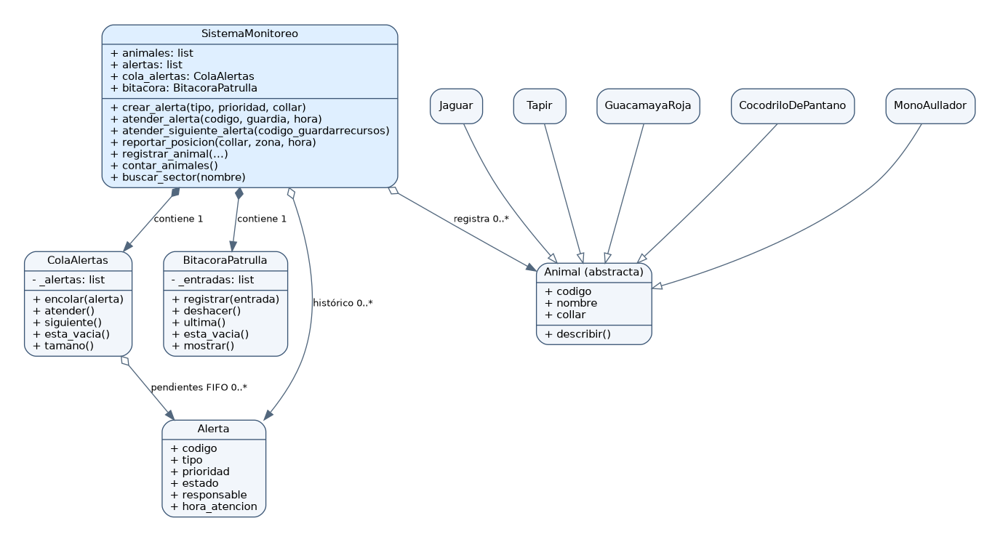

# Guardianes del Petén — Entrega 6: Colas y pilas

**Estudiante:** Yancy Samantha Jimena Lopez Davila  
**Carné:** 202605658  
**Grupo:** 2  
**Curso:** Fundamentos de Programación 2 (IS24-FP2)  
**Fecha:** 22 de noviembre de 2026

## Descripción

Mi proyecto simula el monitoreo de animales del Petén mediante collares GPS. Registro animales, zonas, avistamientos, lecturas, alertas y atención por guardarrecursos. Conservo las funciones anteriores de herencia, polimorfismo y recursividad, y agrego una cola de alertas y una bitácora de patrulla.

## Entrega 6: nuevas estructuras

- `ColaAlertas`: implementa una cola FIFO mediante una lista privada `_alertas` con los métodos `encolar`, `atender`, `siguiente`, `esta_vacia` y `tamano`. La primera alerta recibida es la primera atendida.
- `BitacoraPatrulla`: implementa una pila LIFO mediante una lista privada `_entradas`, con `registrar`, `deshacer`, `ultima`, `esta_vacia` y `mostrar`. La anotación más reciente se deshace primero.
- `SistemaMonitoreo`: mantiene el historial original `alertas` y además envía las nuevas alertas a `cola_alertas`. `atender_siguiente_alerta(codigo_guardarrecursos)` atiende la siguiente alerta pendiente siguiendo el artículo 8 y registra la atención en `bitacora`. Si no quedan alertas, imprime `No hay alertas por atender` y devuelve `None`.

## Diagrama de clases



Las relaciones principales son: `SistemaMonitoreo` contiene una `ColaAlertas` y una `BitacoraPatrulla`; la cola almacena objetos `Alerta`, y el sistema conserva un historial de alertas independiente. Las especies heredan de `Animal`.

## Cómo ejecutar

Abro una terminal dentro de la carpeta del proyecto y ejecuto:

```bash
py main.py
```

Si utilizo otro sistema con Python instalado, puedo ejecutar `python main.py`.

**Importante:** el proyecto necesita todos los archivos `.py` de las entregas previas, incluido `pruebas_entrega5.py`, porque `main.py` lo importa. Este archivo debe estar en la misma carpeta del resto del proyecto.

## Pruebas de la Entrega 6

En `main.py` ejecuto lo siguiente:

1. Genero cuatro alertas y compruebo el tamaño de la cola y el código de la próxima alerta (`AL-001`).
2. Atiendo dos alertas y compruebo que salen `AL-001` y `AL-002`, en ese orden.
3. Registro cuatro anotaciones nuevas en la bitácora; deshago la última y muestro las restantes desde la más reciente hasta la más antigua.
4. Atiendo las dos alertas restantes, vuelvo a llamar al método cuando la cola está vacía y compruebo que devuelve `None` sin generar errores.

También ejecuto las pruebas de las entregas anteriores.

## Evidencia

Adjunto en este repositorio `captura_entrega6.png`, tomada al ejecutar `py main.py`, mostrando las pruebas de FIFO, LIFO y el mensaje de cola vacía.
