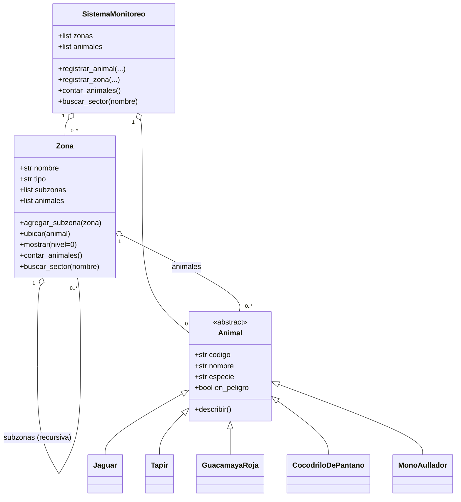

# Guardianes del Petén — Entrega 5: Recursividad

**Estudiante:** Yancy Samantha Jimena Lopez Davila  
**Carné:** 202605658  
**Grupo:** 2  
**Fecha:** 15 de noviembre de 2026  
**Curso:** Fundamentos de Programación 2

## Presentación

En esta entrega amplié la estructura de las zonas para crear sectores y aguadas dentro de otras zonas. Utilicé recursividad para mostrar todo el mapa de la reserva, contar los animales y buscar un sector por su nombre, sin depender de un número fijo de niveles.

## Funciones nuevas

- `Zona.agregar_subzona(zona)` incorpora zonas del tipo permitido por R5.
- `Zona.ubicar(animal)` agrega animales.
- `Zona.mostrar(nivel=0)` imprime el árbol usando dos espacios por nivel.
- `Zona.contar_animales()` suma animales propios y de todas las subzonas.
- `Zona.buscar_sector(nombre)` devuelve la zona encontrada o `None`.
- `SistemaMonitoreo.contar_animales()` y `SistemaMonitoreo.buscar_sector(nombre)` buscan entre zonas de primer nivel.

## Diagrama de clases actualizado



## Pruebas

Ejecuté `main.py` con las pruebas antiguas recuperadas de mi material y con las pruebas nuevas. Se construyen **7 zonas**, con tres niveles debajo de la reserva, y se ubican **5 animales** en diferentes niveles. El conteo de toda la reserva es **5** y el de Laguna del Tigre es **4**. Se busca una aguada profunda, una zona de primer nivel y una inexistente; esta última devuelve `None`.

## Ejecución en Windows

Descomprimir todos los archivos en una misma carpeta. Abrir CMD en esa carpeta y ejecutar:

```bat
py main.py
```

La salida comprobada está en `salida_ejecucion.txt`.

## Nota sobre continuidad

Esta carpeta fue reconstruida a partir del código de la Entrega 3 recuperado del documento anterior y de la ampliación recursiva de la Entrega 5. No se contó con los archivos `.py` exactos de la Entrega 4 mostrada en capturas. **Antes de entregar como continuidad definitiva de la Entrega 4, integrar las modificaciones de esta versión con el código original de la Entrega 4 (si incluye cambios adicionales).**

## Publicación

Crear un repositorio público de GitHub, subir todos los archivos `.py`, este `README.md`, el diagrama de clases y una captura real de `py main.py`; finalizar con un commit y copiar el enlace del repositorio en la tarea.
